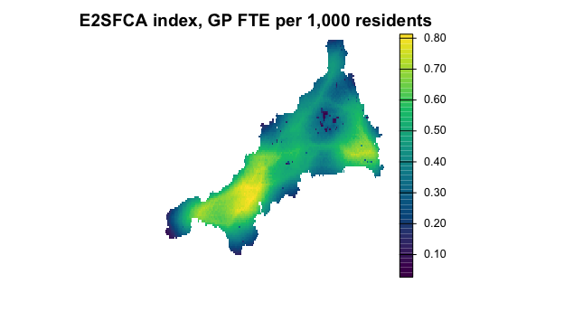
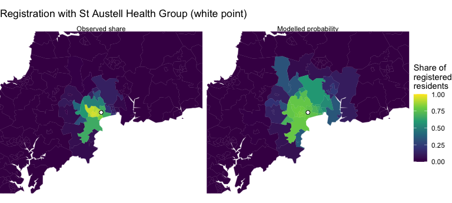

<!-- README.md is generated from README.Rmd. Please edit that file -->

# spax: spatial accessibility and allocation modeling

<!-- badges: start -->

[](https://doi.org/10.5281/zenodo.23438611)
<!-- badges: end -->

`spax` is a modular engine for spatial access and allocation models.
Floating catchment area (FCA) methods and an allocation model share the
same inputs (demand, facility supply and travel times), decay kernels
and numeric engine, so you can:

- compute accessibility surfaces with the FCA family: 2SFCA, E2SFCA,
  M2SFCA, 3SFCA and Huff-2SFCA;
- model where people go with a static conditional logit allocation
  (`spec_clm()`) that includes the Huff model (`spec_huff()`) and
  extends it with an outside option for demand that goes elsewhere:
  evaluate it at chosen parameters, fit it to observed use (facility
  totals or origin-to-facility flows), predict for new areas and test
  supply scenarios;
- compare models, including FCA scores and fitted allocations on the
  same inputs;
- work with several demand groups that compete for the same facilities,
  such as age bands, or people who drive and people who take the bus; a
  group-specific allocation parameter is fitted only from counts
  recorded by group;
- plug in your own decay kernels, fitting losses, weights and spatially
  varying catchments.

The pieces are built to be combined and extended: a new component uses
the same engine rather than a separate code path. Large rasters are read
in blocks, so the FCA functions run in modest memory. The FCA functions
are stable; the allocation functions are experimental and may change in
later versions.

## Install

Use R 4.4.0 or newer. This is the supported dependency and testing floor
for spax 0.5.0. Calls from earlier versions keep working (see the NEWS).

Install version 0.5.0 by its release tag rather than from the
repository’s default branch:

``` r
# install.packages("pak")
pak::pak("Songyosr/spax@v0.5.0")
```

The allocation interface is experimental and may change in later
versions. For reproducible work, record the package version and retain
the input IDs, units, observation declaration and saved results.
Development continues on the `develop` branch
(`pak::pak("Songyosr/spax@develop")`).

Each release is archived on Zenodo; <doi:10.5281/zenodo.23438611> refers
to all versions (version 0.4.0 is <doi:10.5281/zenodo.23495125>). Cite
the version you used with `citation("spax")`.

Package and function help are available from an installed package.
Installations that include built articles also provide the guides, which
follow one reader journey: Get started, the example data and data
preparation, the FCA guides, then the allocation model (model choice,
the workflow and bootstrap intervals):

``` r
# Package overview, and notes on reusing saved results
help(package = "spax")
help("spax-package", package = "spax")
help("allocation-compatibility", package = "spax")

# The guides
browseVignettes("spax")
# When the installation includes built vignettes:
vignette("spax", package = "spax")  # Get started
vignette("cornwall-data", package = "spax")
vignette("model-choice", package = "spax")
vignette("allocation-workflow", package = "spax")
vignette("facility-bootstrap", package = "spax")
```

## Quick start: GP practices in Cornwall

spax ships open example data for the 55 general practices of Cornwall
and the Isles of Scilly: practice locations and GP full-time equivalents
(FTE, excluding GPs in training) in `cornwall_gp`, small areas with
registered residents in `cornwall_lsoa`, small area × practice
registrations in `cornwall_flows` and travel minutes in
`cornwall_travel`, plus a WorldPop 2020 population grid and one
travel-time layer per practice. The Isles of Scilly have no road link to
the mainland, so this example models mainland Cornwall only: it drops
the islands’ practice and small area, and crops the islands from the
grids. `vignette("cornwall-data", package = "spax")` describes each
object, its sources and its licences.

### An FCA accessibility map

An FCA index takes a demand raster, a facility table and one travel
layer per facility, with layer names matching facility IDs.
`prep_data()` holds them together, a specification such as
`spec_e2sfca()` declares the index without data, and `spax()` computes
it. This interface is experimental.

``` r
library(spax)
library(terra)
library(sf)
library(dplyr)
library(ggplot2)

# Mainland practices, as a plain table
mainland_gp <- cornwall_gp |>
  filter(!scilly) |>
  st_drop_geometry()

# Residents per grid cell, and travel minutes with one layer per practice;
# crop both to the mainland (west edge at 6 degrees W)
pop <- read_spax_example("cornwall_pop.tif")
travel_grid <- read_spax_example("cornwall_gp_travel.tif")
mainland <- ext(-6, xmax(pop), ymin(pop), ymax(pop))
pop <- crop(pop, mainland)
travel_grid <- crop(travel_grid[[mainland_gp$practice]], mainland)

# Demand grid, practice table and travel stack, held together
grid_data <- prep_data(
  pop,
  mainland_gp,
  travel_grid,
  id_col = "practice",  # matches supply rows to travel layers
  supply_cols = "gp_fte_extg"
)

# The E2SFCA index with a 10-minute Gaussian decay
fca <- spax(grid_data, spec_e2sfca(decay = decay_gaussian(sigma = 10)))

plot(
  1000 * fca$accessibility,
  axes = FALSE,
  col = hcl.colors(50, "viridis"),
  main = "E2SFCA index, GP FTE per 1,000 residents"
)
```



This is an enhanced two-step FCA index: supply per distance-weighted
population, in GP FTE per 1,000 residents. The 10-minute Gaussian scale
is a choice for this example, not an estimate. The index is a
supply-per-demand score, not a probability that anyone uses a practice.
`spax_e2sfca()` remains the one-call shortcut and gives the same result
from the same inputs. See `?spec_e2sfca` for the other FCA indices,
decays and normalization options, and `summary(fca)` or `plot(fca)` to
inspect the result.

### A static CLM fitted to registrations

The allocation model takes numeric vectors and an origin-by-facility
travel matrix, and fits where people choose to go. Here demand is the
residents of each small area registered with any GP practice in England,
supply is GP FTE, and the target is the observed small area × practice
registrations. The model includes an outside option, which here stands
for registration with a practice outside mainland Cornwall (for example
in Devon or on the Isles of Scilly); it is not unmet need.

``` r
mainland_lsoa <- cornwall_lsoa |>
  filter(!scilly) |>
  st_drop_geometry()

# Travel minutes (small areas x practices), demand and supply, named by ID
travel <- cornwall_travel[mainland_lsoa$lsoa, mainland_gp$practice]
demand <- setNames(mainland_lsoa$registered, mainland_lsoa$lsoa)
supply <- setNames(mainland_gp$gp_fte_extg, mainland_gp$practice)

# Align the inputs once; unit labels are recorded, not converted
d <- prep_data(
  demand = demand,
  supply = supply,
  travel = travel,
  metadata = list(
    demand_units = "registered residents",
    demand_period = "July 2026",
    supply_units = "GP FTE excluding GPs in training",
    supply_period = "June 2026",
    travel_units = "minutes"
  )
)
d
```

    <spax data> 336 origins (336 active) x 54 facilities
      demand      604,471 registered residents (July 2026)
      supply      GP FTE excluding GPs in training (June 2026)
      travel      minutes; unknown for 0 active origins
      policies    missing demand: error; missing travel: error

``` r
# Observed registrations: one row per small area and practice
flows <- obs_flows(
  cornwall_flows,
  origin = "lsoa",
  facility = "practice",
  count = "patients"
)
```

``` r
# Gaussian travel decay and a fitted outside weight v0 (the defaults),
# fitted to the flows
clm <- spax(d, spec_clm(), observed = flows)
```

    observed: 2,290 counts from 1 origin outside the data or left out by it are dropped; 5 counts at 1 facility outside the data are not fitted (outside = "known" uses them as outside counts)

``` r
clm
```

    <spax allocation> conditional logit with an outside option
      decay       gaussian (sigma = travel scale): fit
      attraction  (kappa * supply)^beta: kappa = 1, beta = 1
      outside     v0: fit
      data        336 origins x 54 facilities

      parameter  value    status
      sigma      4.591    fitted
      v0         0.02733  fitted
      beta       1        held
      kappa      1        held

      selected    scan1 (start 1 of 3); 3 of 3 starts converged
      boundary    none
      starts      default search, 45 of 45 grid points, loss poisson

`spax()` lines the registrations up with the data. The message says what
it dropped: the counts of the Isles of Scilly small area, which is not
in the data, and the few mainland residents registered at the Scilly
practice, who count towards the outside option. No starts were given, so
`spax()` found them from the data: it scans a grid of travel scales and
outside weights and fits from the best points, as the last line of the
print says. The loss is Poisson, the default of `obs_flows()`.
Registrations are a stock rather than independent events, so treat the
loss as a fitting criterion. `summary(clm)` lists every start; give
`starts`, `lower` and `upper` to choose them yourself.

``` r
coef(clm)
```

         sigma         v0 
    4.59099725 0.02733454 

``` r
# The observed counts as aligned with the data (small areas x practices)
observed <- clm$observed$target

# Per cent registered outside mainland Cornwall: observed and modelled
outside <- c(
  observed = 1 - sum(observed) / sum(demand),
  modelled = 1 - sum(fitted(clm)) / sum(demand)
)
round(100 * outside, 2)
```

    observed modelled 
        0.91     0.54 

``` r
# Practice totals: modelled against observed
cor(colSums(fitted(clm)), colSums(observed))
```

    [1] 0.9326925

The fitted Gaussian scale is about 4.6 minutes: registration is very
local. The printed shares are percentages of registered residents.
Practice totals of the fitted flows correlate at 0.93 with the observed
ones. One constant outside weight understates registration outside
mainland Cornwall, which is concentrated in a few areas near the Devon
border.

`predict()` returns choice probabilities for requested areas. For the
practice with the largest list, St Austell Health Group, the modelled
probability can be set beside the observed share of each area’s
registered residents:

``` r
# Choice probabilities for every small area
prediction <- predict(
  clm,
  travel = travel,
  demand = demand,
  outputs = "allocation"
)

# Observed share and modelled probability for one practice, in one table
st_austell <- "Y04957"  # St Austell Health Group
shares <- bind_rows(
  data.frame(
    lsoa = rownames(travel),
    source = "Observed share",
    value = observed[, st_austell] / demand
  ),
  data.frame(
    lsoa = rownames(travel),
    source = "Modelled probability",
    value = prediction$outputs$allocation[, st_austell]
  )
) |>
  mutate(source = factor(source, unique(source)))

# Join to the small-area polygons, and locate the practice
mapped <- cornwall_lsoa |>
  select(lsoa) |>
  inner_join(shares, by = "lsoa")
site <- filter(cornwall_gp, practice == st_austell)
xy <- st_coordinates(site)

ggplot(mapped) +
  geom_sf(aes(fill = value, colour = value), linewidth = 0.1) +
  geom_sf(data = site, shape = 21, fill = "white", size = 2) +
  facet_wrap(~source) +
  scale_fill_viridis_c(
    name = "Share of\nregistered\nresidents",
    limits = c(0, 1),
    aesthetics = c("fill", "colour")
  ) +
  # A 50 x 40 km window around the practice
  coord_sf(xlim = xy[1] + c(-25000, 25000), ylim = xy[2] + c(-20000, 20000)) +
  labs(title = "Registration with St Austell Health Group (white point)") +
  theme_void() +
  theme(plot.title = element_text(margin = margin(b = 8)))
```



The model reproduces the catchment’s location but spreads it more widely
than the observed registrations. Registrations record where residents
are registered, not how often they visit. The population grid (WorldPop
2020) and the registrations (NHS England, 2026) are different sources
and dates. Data sources and licences are listed in
`system.file("COPYRIGHTS", package = "spax")`.

### Known outside counts

The fit above sees only the counts at the mainland practices, so the
outside option is fitted without any count of its own. Here the outside
count of every small area is known. Demand is the residents registered
with any GP practice in England, and every registered resident is
registered somewhere, so the residents of a small area who are not
registered at a mainland practice are exactly its outside count: its
demand less its counts at the mainland practices, including the few
mainland residents registered at the Scilly practice.
`outside = "known"` declares this, and `spax()` fits the outside count
as one more cell of each small area.

``` r
clm_known <- spax(
  d,
  spec_clm(),
  observed = obs_flows(
    cornwall_flows,
    origin = "lsoa",
    facility = "practice",
    count = "patients",
    outside = "known"
  )
)
coef(clm_known)
```

         sigma         v0 
    4.61941763 0.04864483 

``` r
# Per cent registered outside mainland Cornwall: observed and modelled
areas_known <- as.data.frame(clm_known, type = "origins")
known_shares <- c(
  observed = sum(areas_known$outside_observed),
  modelled = sum(areas_known$outside_modelled)
) / sum(areas_known$demand)
round(100 * known_shares, 2)
```

    observed modelled 
        0.91     0.91 

The travel scale hardly moves, but the outside weight rises from 0.027
to 0.049, and the modelled outside share now equals the observed one:
with every outside count known by subtraction (demand minus the counts),
the fit is the multinomial likelihood of each small area’s choices, and
a constant outside weight reproduces the total outside count. Use
`outside = "known"` only when demand counts the same people as the
observations, as here: registrations by residence from the same extract
and date. It is not a population estimate; list sizes and population
differ by several percent, and the gap would go straight into the
outside counts. The Huff comparison below uses the flows without outside
counts, because the Huff model has no outside option.

### The Huff model on the same data

The Huff model is the conditional logit without the outside option.
`spec_huff()` specifies it; by default it uses power decay and a fitted
attractiveness exponent `beta`, the usual form of the Huff model. Here
it takes the same Gaussian decay and `beta = 1` as the conditional logit
above, so the two fits differ only in the outside option. Without one,
the model sends every registered resident to a mainland practice, and
the counts at the Scilly practice are dropped.

``` r
huff <- spax(d, spec_huff(decay = decay_gaussian(), beta = 1), observed = flows)
```

    observed: 2,290 counts from 1 origin outside the data or left out by it are dropped; 5 counts at 1 facility outside the data are dropped (the Huff model has no outside option)

``` r
coef(huff)
```

       sigma 
    4.590493 

``` r
# Same flows, loss and inputs; loss differences are measured from the Huff fit
comparison <- compare_allocations(list(huff = huff, clm = clm))
as.data.frame(comparison)[
  c("specification", "parameters", "loss_difference", "count_correlation")
]
```

      specification              parameters loss_difference count_correlation
    1          huff              sigma=4.59         0.00000         0.8838864
    2           clm sigma=4.591, v0=0.02733       -72.51419         0.8846533

The outside option moves the travel scale very little (from 4.590 to
4.591 minutes) and lowers the Poisson loss by 72.5. It lets the model
send 0.54% of registered residents outside mainland Cornwall, against
0.91% observed. The Huff model is nested in the conditional logit, so
this comparison measures what the outside option adds on these
registrations; it does not by itself show how residents choose
practices.

## Continue the allocation workflow

| Function | Purpose |
|:---|:---|
| `prep_data()` | Align demand, supply and travel by ID once, and record units. |
| `spec_clm()`, `spec_huff()` | Specify a model without data; each parameter is a number (held) or `"fit"` (estimated). |
| `decay_gaussian()`, `decay_exponential()`, `decay_power()`, `decay_custom()` | Declare the decay kernel of a specification, with its `sigma`. |
| `obs_flows()`, `obs_totals()` | Declare observed flows or facility totals, and the loss that fits them. |
| `spax()`, `spax_clm()`, `spax_huff()` | Fit the model, or evaluate it at given values; `coef()`, `fitted()`, `summary()`, `as.data.frame()` and `predict()` read the result. |

For full control, the step functions run the same model one step at a
time, and they accept a result of `spax()`:

| Function | Purpose |
|:---|:---|
| `prepare_allocation()` | Align IDs, record units and support, and prepare compact numeric inputs (`prep_data()` returns the same object). |
| `clm_allocation()` | Declare corrected static CLM with Gaussian, exponential or power travel decay, or a kernel declared with `decay_kernel()`. |
| `huff_allocation()` | Declare the Huff model: the same allocation model without an outside option, with power decay and a fitted attractiveness exponent by default. |
| `fit_allocation()` | Fit a selected output from given starts, or from starts found in the data, and retain diagnostics. |
| `evaluate_allocation()` | Evaluate supplied parameters, including a newly prepared supply scenario. |
| `predict_allocation()` | Predict requested origins against saved facility loads; maps are explicit. |
| `check_fit()`, `compare_fits()` (also `check_allocation()`, `compare_allocations()`) | Compare a fit with simpler models, or fits with each other, on the same loss. |
| `bootstrap_fit()` (also `bootstrap_allocation()`) | Run the separately supported conditional facility-case bootstrap. |

`vignette("model-choice", package = "spax")` compares an FCA index and
the static CLM on the same Cornwall inputs and explains what each output
means.

A supply scenario requires preparing the changed system and evaluating
it at the selected parameters. Supply can change attraction, allocation
and loads. This is a model-based comparison, not a causal intervention
estimate.

The bootstrap has a narrower scope than fitting: static CLM with a
fitted outside mass `v0` and a decay kernel that is smooth in `sigma`
(built in, or declared with `decay_kernel()`; a fitted `beta` is
allowed), complete whole facility counts and an unweighted Poisson
original fit. It requires an explicit event, reference period and
independent-facility sampling declaration. The Cornwall fit above
targets small area × practice flows, so it is outside this method.
`vignette("facility-bootstrap", package = "spax")` supplies a generated
example with all 399 attempts and a paired supply comparison;
`vignette("allocation-workflow", package = "spax")` covers fitting,
prediction, a supply scenario and fresh-session export on the Cornwall
data.

Conditional percentile intervals require an eligible original, a
complete run of 399 attempts and at least 380 finite successful values
for the quantity. Failed attempts and successful inner-boundary fits
remain visible. Coverage was evaluated for Gaussian decay with fitted
`sigma` and `v0`, in generated 80-origin/40-facility designs under
tested fixed-input laws; other kernels and a fitted `beta` use the same
procedure without a separate coverage study. This is not a universal
coverage guarantee or evidence for an application’s observation law. No
spatial simultaneous intervals are provided.

## IDs, support and saved results

Keep facility IDs on supply, travel and observations; named axes align
independently. Unnamed inputs are positional. Distinguish known zero
demand, unknown demand and excluded origins. Only included positive
demand contributes to fitted facility loads. For CLM prediction, unknown
travel and known absence (`Inf`) have different meanings; inspect
validity flags rather than replacing all missing values with zero.
Declare compatible units and reference periods; the interface does not
convert them.

Use `coef()`, `fitted()`, `summary()`, `plot()` and `as.data.frame()` to
inspect saved allocation results. CSV drops R attributes, so keep an RDS
bundle with declarations and support metadata. See
`help("allocation-compatibility", package = "spax")` before reusing
older private fits: corrected CLM and legacy `huff_decay` have different
output meanings, and older objects may need regeneration for current
prediction/reporting.

## Contributing and license

Report reproducible issues or discuss larger changes on the [project
repository](https://github.com/Songyosr/spax). Package code uses the MIT
license; see [LICENSE](LICENSE.md). The bundled Cornwall GP example data
are openly licensed third-party material (Open Government Licence v3.0
and Creative Commons Attribution), which the MIT license does not cover.
The installed notice file, `system.file("COPYRIGHTS", package = "spax")`
(source `inst/COPYRIGHTS`), lists each source and its required
attribution; the exact Creative Commons version of the travel-friction
source is still unconfirmed.
