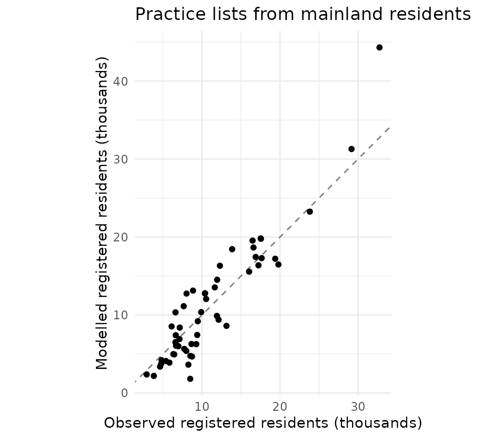
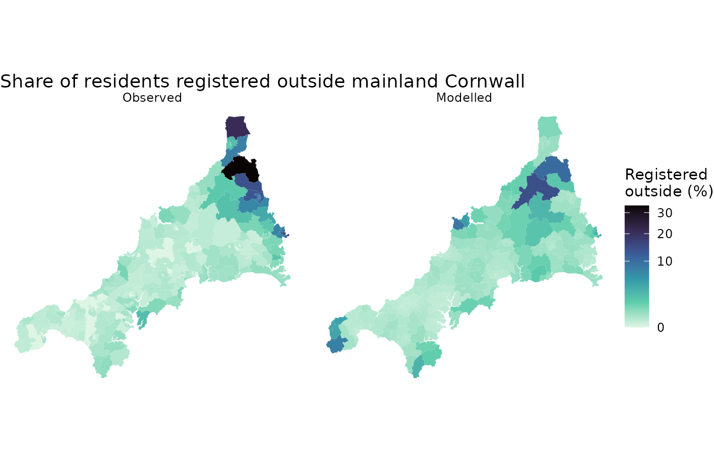
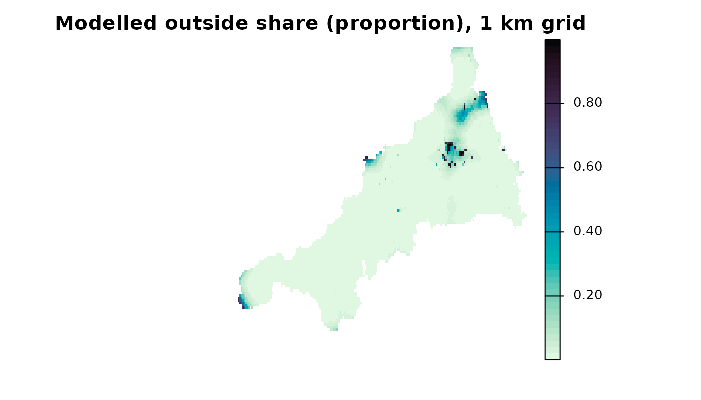
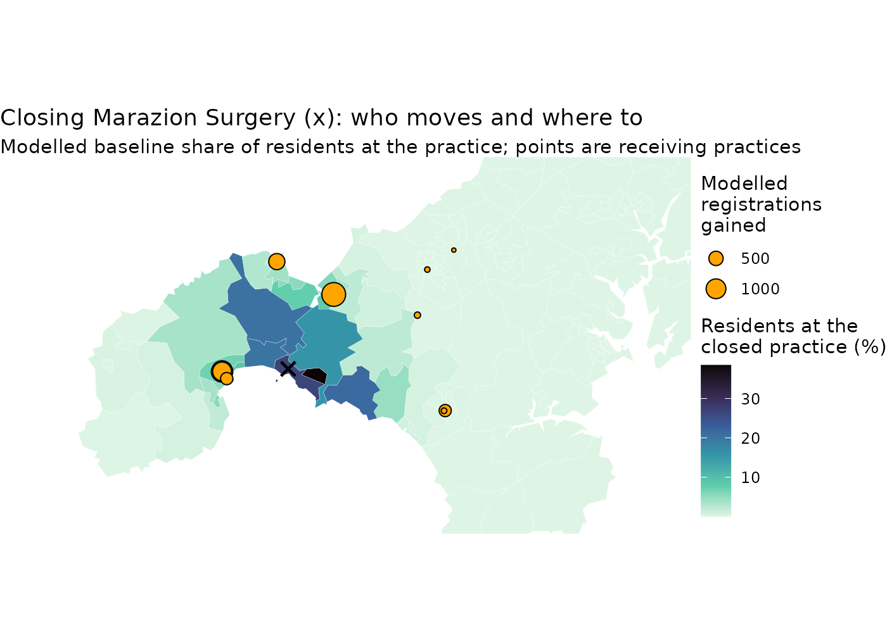

# Fitting an allocation model to GP registrations in Cornwall

This guide uses the bundled Cornwall GP data, described in [The Cornwall
GP example
data](https://songyosr.github.io/spax/articles/cornwall-data.md).

This guide runs the experimental allocation workflow from start to
finish. It first fits the model in one call with
[`spax()`](https://songyosr.github.io/spax/reference/spax.md), then
works through the steps one at a time: prepare inputs, declare a model,
fit it to observed registrations, inspect the saved fit, predict at new
locations, compare a change in one practice’s supply, declare a decay
function of your own, and export the results and read them back in a
fresh R session. Bootstrap intervals have their own guide, [Bootstrap
intervals for a fitted allocation
model](https://songyosr.github.io/spax/articles/facility-bootstrap.md),
on generated data.

The model is a corrected static conditional logit (CLM) with an explicit
outside option. Each practice attracts residents in proportion to its
supply, discounted by travel time; the outside option competes with all
practices. For choosing between this model and an FCA index, see
[Choosing an FCA index or an allocation
model](https://songyosr.github.io/spax/articles/model-choice.md).
[Preparing your own
data](https://songyosr.github.io/spax/articles/data-prep.md) explains
counts, units, IDs and missing travel, and [saved-result
inspection](https://songyosr.github.io/spax/articles/function-naming.md)
describes the standard R methods used below. The interface is
experimental.

``` r

library(spax)
library(terra)
library(sf)
library(dplyr)
library(ggplot2)
```

## The data

The model uses four of the bundled objects: small areas with their
registered residents (`cornwall_lsoa`), practices with their GP
full-time equivalents (FTE, `cornwall_gp`), registrations by small area
and practice (`cornwall_flows`) and travel minutes between them
(`cornwall_travel`). As in the other guides, it covers mainland Cornwall
only, because the Isles of Scilly have no road link to the mainland.

``` r

# Mainland small areas and practices, as plain tables
areas <- cornwall_lsoa |>
  filter(!scilly) |>
  st_drop_geometry()
gp <- cornwall_gp |>
  filter(!scilly) |>
  st_drop_geometry()

# Travel minutes: small areas in rows, practices in columns
travel <- cornwall_travel[areas$lsoa, gp$practice]

# Demand: residents registered with any practice in England.
demand <- setNames(areas$registered, areas$lsoa)
# Supply: GP FTE excluding GPs in training.
supply <- setNames(gp$gp_fte_extg, gp$practice)

# Observed flows: registered residents by small area (rows) and practice.
observed <- matrix(
  0,
  nrow = nrow(travel),
  ncol = ncol(travel),
  dimnames = dimnames(travel)
)
keep <- cornwall_flows$lsoa %in% rownames(travel) &
  cornwall_flows$practice %in% colnames(travel)
observed[cbind(cornwall_flows$lsoa[keep], cornwall_flows$practice[keep])] <-
  cornwall_flows$patients[keep]

dim(travel)
```

``` spax-output
[1] 336  54
```

``` r

c(registered = sum(demand), at_mainland_practices = sum(observed))
```

``` spax-output
           registered at_mainland_practices 
               604471                598974 
```

Registrations are a stock: who is registered where in July 2026, not a
count of visits. Because demand counts every registered resident, the
outside option stands for registration with a practice outside mainland
Cornwall (in Devon, for example, or on the Isles of Scilly). It is not
unmet need: almost everyone is registered with some practice.

## Fit in one call

[`spax()`](https://songyosr.github.io/spax/reference/spax.md) runs an
allocation model in one call. It takes three pieces: the data from
[`prep_data()`](https://songyosr.github.io/spax/reference/prep_data.md),
a model specification and the observed counts.
[`spec_clm()`](https://songyosr.github.io/spax/reference/spec_clm.md)
specifies the conditional logit: here a Gaussian travel kernel with
scale σ (minutes) and an outside weight v0, both `"fit"`, that is,
estimated.
[`obs_flows()`](https://songyosr.github.io/spax/reference/obs_flows.md)
declares the observed small area × practice matrix and the loss that
fits it, Poisson by default. Unit and period labels are declarations
attached to the results; spax does not convert units.

``` r

# Labels kept with the inputs and every result derived from them
cornwall_units <- list(
  demand_units = "registered residents",
  demand_period = "July 2026",
  supply_units = "GP FTE excluding GPs in training",
  supply_period = "June 2026",
  travel_units = "minutes"
)

d <- prep_data(
  demand = demand,
  supply = supply,
  travel = travel,
  metadata = cornwall_units
)

clm <- spax(
  data = d,
  model = spec_clm(decay = decay_gaussian(sigma = "fit"), outside = "fit"),
  observed = obs_flows(observed)
)
clm
```

``` spax-output
<spax allocation> conditional logit with an outside option
  decay       gaussian (sigma = travel scale): fit
  attraction  (kappa * supply)^beta: kappa = 1, beta = 1
  outside     v0: fit
  data        336 origins x 54 facilities

  parameter  value    status
  sigma      4.591    fitted
  v0         0.02733  fitted
  beta       1        held
  kappa      1        held

  selected    scan1 (start 1 of 3); 3 of 3 starts converged
  boundary    none
  starts      default search, 45 of 45 grid points, loss poisson
```

``` r

coef(clm)
```

``` spax-output
     sigma         v0 
4.59099725 0.02733454 
```

No starts were given, so
[`spax()`](https://songyosr.github.io/spax/reference/spax.md) found them
from the data. It probes the Gaussian kernel for the range of σ over
which it decays across these travel times, scans that range with outside
weights seeded from the observed outside share, and fits from the best
points of the scan. The last line of the print records the search, and
`summary(clm)` shows every start. To choose the starts and bounds
yourself, give `starts`, `lower` and `upper`, as in
[`fit_allocation()`](https://songyosr.github.io/spax/reference/fit_allocation.md).

## The same fit step by step

[`spax()`](https://songyosr.github.io/spax/reference/spax.md) builds the
objects of this section: the model bound to the data (`clm$model`, the
same model that
[`clm_allocation()`](https://songyosr.github.io/spax/reference/clm_allocation.md)
declares below) and the multistart fit of
[`fit_allocation()`](https://songyosr.github.io/spax/reference/fit_allocation.md)
(`clm$fit`), from the starts it found. The step functions accept the
result itself, for example `check_allocation(clm)`.

[`prepare_allocation()`](https://songyosr.github.io/spax/reference/prepare_allocation.md)
aligns demand, supply and travel by their names and checks them once;
[`prep_data()`](https://songyosr.github.io/spax/reference/prep_data.md)
returns the same object.
[`clm_allocation()`](https://songyosr.github.io/spax/reference/clm_allocation.md)
then declares the model: a Gaussian travel kernel with scale σ (minutes)
and a fitted outside weight v0.

The Huff model is this model without the outside option, and
[`huff_allocation()`](https://songyosr.github.io/spax/reference/huff_allocation.md)
declares it. The guide uses `clm_allocation(fit_v0 = TRUE)` because some
registrations go to practices outside mainland Cornwall.

``` r

# The same inputs, with the labels declared above
inputs <- prepare_allocation(
  demand = demand,
  supply = supply,
  distance = travel,
  metadata = cornwall_units
)

model <- clm_allocation(
  inputs = inputs,
  family = "gaussian",
  fit_v0 = TRUE  # estimate the outside weight
)
```

[`fit_allocation()`](https://songyosr.github.io/spax/reference/fit_allocation.md)
runs one fit from each supplied start and keeps the best converged one.
Here the target is the small area × practice flow matrix and the loss is
Poisson, chosen explicitly: asking for counts does not choose a
likelihood. Registrations are not independent event counts, so treat the
Poisson loss as a fitting criterion rather than a full observation
model. Joint Poisson fitting does not force the modelled total to match
the observed total.

``` r

# Three starting points, from a short to a long travel scale
starts <- rbind(
  near = c(sigma = 3, v0 = 0.05),
  middle = c(sigma = 6, v0 = 0.01),
  far = c(sigma = 12, v0 = 0.002)
)

fit <- fit_allocation(
  model = model,
  observed = observed,
  starts = starts,
  lower = c(sigma = 0.5, v0 = 1e-6),
  upper = c(sigma = 60, v0 = 10),
  output = "flow",  # fit the small area x practice matrix
  loss = "poisson",
  gradient = TRUE,
  control = list(maxit = 300, factr = 10, pgtol = 1e-8)
)

# Every start, then the selected parameters as a table
summary(fit)
```

``` spax-output
<summary.ae_multistart_fit>
status: selected; selected start: near
loss disagreement: FALSE; parameter disagreement: FALSE
Supplied-start diagnostics (not a global-optimum or identification guarantee):
  start     loss eligible optim_convergence solver_converged residual seconds
   near -3168000     TRUE                 0             TRUE        0   0.305
 middle -3168000     TRUE                 0             TRUE        0   0.218
    far -3168000     TRUE                 0             TRUE        0   0.677
 boundary   status                                   optim_message
    FALSE eligible CONVERGENCE: REL_REDUCTION_OF_F <= FACTR*EPSMCH
    FALSE eligible CONVERGENCE: REL_REDUCTION_OF_F <= FACTR*EPSMCH
    FALSE eligible CONVERGENCE: REL_REDUCTION_OF_F <= FACTR*EPSMCH
 solver_message log_parameter_gap loss_gap
      converged         0.000e+00        0
      converged         1.759e-07        0
      converged         2.755e-07        0

Selected fit:
<summary.ae_problem_nfxp_fit>
model: clm
family: gaussian (sigma = travel scale)
allocation_form: clm

theta:
 parameter estimate
     sigma  4.59100
        v0  0.02733

fit:
     loss convergence seconds spectral_radius gradient
 -3168000           0   0.297               0     TRUE

predicted:
        min       q25   median  mean      q75  max
 1.072e-162 8.783e-40 8.28e-15 33.14 0.002554 2872

state:
   min   q25 median  mean  q75   max
 1.133 3.272   4.88 5.765 7.93 13.36

residual:
   min       q25   median   mean       q75  max
 -1932 6.052e-59 6.31e-22 0.1232 2.367e-06 1135
```

``` r

as.data.frame(fit)
```

``` spax-output
  parameter   estimate
1     sigma 4.59099725
2        v0 0.02733455
```

The summary keeps every start, its convergence, boundaries and messages.
The estimates agree with the one-call fit above. The starts stop away
from the bounds and very close to each other. With the strict tolerance
used here (`factr = 10`), a start can end with a line-search message at
practically the same loss, so judge agreement by the losses and
parameters in the per-start table rather than by the convergence codes
alone. The disagreement flag uses deliberately strict default
tolerances, so read the gaps in the per-start table rather than the flag
alone. Agreement among the supplied starts is a numerical check; it does
not prove a global optimum or that the parameters are identified.

A σ of about 4.6 minutes means registration is very local: a practice 9
minutes away keeps only about 15% of the pull it would have next door.

## Fitted against observed

[`fitted()`](https://rdrr.io/r/stats/fitted.values.html) returns the
saved fitted flows; nothing is recomputed. Summing over small areas
gives each practice’s modelled registered list.

``` r

# Observed and modelled list size of each practice
practices <- data.frame(
  practice = colnames(observed),
  observed = colSums(observed),
  fitted = colSums(fitted(fit))
)
cor(practices$observed, practices$fitted)
```

``` spax-output
[1] 0.9326925
```

``` r

ggplot(practices, aes(observed / 1000, fitted / 1000)) +
  geom_abline(linetype = 2, colour = "grey50") +
  geom_point() +
  coord_equal() +
  labs(
    x = "Observed registered residents (thousands)",
    y = "Modelled registered residents (thousands)",
    title = "Practice lists from mainland residents"
  ) +
  theme_minimal()
```



The model gives each practice an attraction proportional to its GP FTE
and uses only supply and travel. Practices with more registered patients
per GP FTE than their neighbours therefore have larger observed than
modelled lists and sit below the dashed line.

## What the observations identify

A good fit does not show that the travel kernel is right.
[`check_allocation()`](https://songyosr.github.io/spax/reference/check_allocation.md)
never changes the fit; it compares the fitted model, on the same loss,
with the same model without distance decay (each small area chooses
among the practices it can reach in proportion to GP FTE), and reports
the one-way trips each implies.

``` r

# The fit against an allocation without distance decay
check_allocation(model, fit)
```

``` spax-output
<ae_allocation_check>
    comparator     loss loss_difference contact trip_median trip_p90
        fitted -3168283               0  0.9946           3       10
      no_decay -1567076         1601207  0.9909          39       84
 capacity_only       NA              NA      NA          NA       NA
Trip lengths are one-way, in minutes, weighted by expected flows.

The fitted allocation reproduces the observations better than the allocation
without distance decay. The capacity-only comparator applies to facility totals only.
```

Here the target is the small area × practice matrix, which records where
each practice’s patients live, so dropping distance decay worsens the
fit by a wide margin, and the fitted model’s trips are short (a median
of a few minutes). When only practice totals are observed, the check
also fits an allocation that shares the totals by capacity alone. If
that, or the no-decay allocation, fits at least as well as the model,
the totals do not identify distance decay: the fitted value then depends
on which travel times were treated as reachable, not on the counts.

The outside share is the other observable output. Each small area’s
modelled outside share can be compared with the share of its residents
registered outside mainland Cornwall.

``` r

# Solve the model once at the fitted parameters
evaluated <- evaluate_allocation(model = model, theta = coef(fit))

# Outside shares and flows for the fitted small areas
baseline <- predict_allocation(
  source = evaluated,
  distance = travel,
  demand = demand,
  outputs = c("outside_share", "flow")
)
table(baseline$validity$status)
```

``` spax-output

valid 
  336 
```

``` r

# Observed and modelled outside shares in one long table
outside <- bind_rows(
  data.frame(
    lsoa = names(demand),
    share = 1 - rowSums(observed) / demand,
    source = "Observed"
  ),
  data.frame(
    lsoa = names(demand),
    share = baseline$outputs$outside_share,
    source = "Modelled"
  )
) |>
  mutate(source = factor(source, c("Observed", "Modelled")))

# Join to the small-area polygons for mapping
outside_map <- cornwall_lsoa |>
  select(lsoa) |>
  inner_join(outside, by = "lsoa")

ggplot(outside_map) +
  geom_sf(aes(fill = 100 * share), colour = NA) +
  facet_wrap(~source) +
  scale_fill_viridis_c(
    option = "mako",
    direction = -1,
    trans = "sqrt",
    name = "Registered\noutside (%)"
  ) +
  labs(title = "Share of residents registered outside mainland Cornwall") +
  theme_void()
```



[`evaluate_allocation()`](https://songyosr.github.io/spax/reference/evaluate_allocation.md)
solves the model once at fixed parameters; it estimates nothing.
[`predict_allocation()`](https://songyosr.github.io/spax/reference/predict_allocation.md)
then returns the requested outputs for any set of origins, with separate
validity flags. Here `flow` is requested demand times choice
probability, in registered residents. Requested demand only scales the
predicted flows; it never changes the saved practice loads.

Observed registration outside mainland Cornwall is concentrated in a few
areas along the Devon border. A single constant outside weight cannot
reproduce that pattern: the model spreads a small outside share
everywhere and puts its largest values where practices are far away, so
treat the modelled outside share as approximate.

## Known outside counts

The fits above see only the counts at the mainland practices, so the
outside option has no count of its own. Here each small area’s outside
count is known: demand counts every resident registered with any
practice in England, so the residents of a small area who are not
registered at a mainland practice are exactly its outside count, its
demand less its counts at the mainland practices. `outside = "known"` in
[`obs_flows()`](https://songyosr.github.io/spax/reference/obs_flows.md)
declares this, and
[`spax()`](https://songyosr.github.io/spax/reference/spax.md) then fits
the outside count as one more cell of each small area, with the same
Poisson loss.

``` r

clm_known <- spax(
  data = d,
  model = spec_clm(),
  observed = obs_flows(observed, outside = "known")
)
coef(clm_known)
```

``` spax-output
     sigma         v0 
4.61941762 0.04864483 
```

``` r

# Observed and modelled outside share, in per cent of registered residents
known_areas <- as.data.frame(clm_known, type = "origins")
known_shares <- c(
  observed = sum(known_areas$outside_observed),
  `fit without outside counts` = sum(demand) - sum(fitted(clm)),
  `fit with known outside counts` = sum(known_areas$outside_modelled)
) / sum(demand)
round(100 * known_shares, 2)
```

``` spax-output
                     observed    fit without outside counts 
                         0.91                          0.54 
fit with known outside counts 
                         0.91 
```

With every outside count known by subtraction (demand minus the counts),
the fit is the multinomial likelihood of each small area’s choices, and
a constant outside weight reproduces the total outside count: the
modelled share equals the observed one, where the fit without outside
counts understates it. The travel scale hardly moves. Per-area outside
counts are in `as.data.frame(clm_known, type = "origins")`
(`outside_observed` and `outside_modelled`), and `fitted(clm_known)` is
the whole target, with the outside count as its last column,
`"(outside)"`.

Declare outside counts as known only when demand counts the same people
as the observations, as here: registrations by residence from the same
extract and date. They are not a population estimate. List sizes and
population differ by several percent, and the gap would go straight into
the outside counts. A model without an outside option, such as
[`spec_huff()`](https://songyosr.github.io/spax/reference/spec_clm.md),
cannot use them, and for facility totals the outside count is one number
you give, never derived from the totals (see
[`?obs_flows`](https://songyosr.github.io/spax/reference/obs_flows.md)).

Fits are compared on the same observation. `clm` and `clm_known` are
fits to different data, so
[`compare_allocations()`](https://songyosr.github.io/spax/reference/compare_allocations.md)
gives no loss difference between them; to compare the Huff model with
the conditional logit, use the same observation without outside counts
for both.

``` r

# Different observations: the loss difference is withheld
compared_known <- compare_allocations(list(without = clm, with = clm_known))
as.data.frame(compared_known)[c("specification", "comparable", "loss_difference")]
```

``` spax-output
  specification comparable loss_difference
1       without       TRUE               0
2          with      FALSE              NA
```

## Predict at new locations

Prediction does not need the fitted small areas. Each cell of the
bundled 1 km population grid has its own travel times to every practice,
so the saved model can predict at every populated cell. A `spatial`
mapping from requested origins to raster cells turns one output into a
map.

``` r

# Population grid, and the travel grid as a cell x practice matrix
pop <- read_spax_example("cornwall_pop.tif")
grid_travel <- values(read_spax_example("cornwall_gp_travel.tif"))

# Keep populated cells and the fitted practices, in the fitted order
populated <- which(is.finite(values(pop)[, 1]) & values(pop)[, 1] > 0)
grid_travel <- grid_travel[populated, colnames(travel)]
rownames(grid_travel) <- paste0("cell", populated)

# Predict at each cell; no demand is needed for probabilities
grid <- predict_allocation(
  source = evaluated,
  distance = grid_travel,
  outputs = c("outside_share", "allocation")
)
table(grid$validity$status)
```

``` spax-output

unknown_travel          valid 
            73           6912 
```

Cells on the Isles of Scilly have no travel time to mainland practices,
so their prediction is marked unknown rather than imputed. Inspect these
flags before reading a map.

``` r

# Which raster cell each requested origin belongs to
grid_spatial <- list(
  template = pop,
  cell_index = setNames(populated, rownames(grid_travel))
)

grid_outside <- predict_allocation(
  source = evaluated,
  distance = grid_travel,
  outputs = "outside_share",
  spatial = grid_spatial,
  type = "raster"  # return a map instead of a table
)
plot(
  grid_outside,
  axes = FALSE,
  col = hcl.colors(50, "Mako", rev = TRUE),
  main = "Modelled outside share (proportion), 1 km grid"
)
```



``` r

# Cells with an outside share above 0.5, and their share of the population
grid_pop <- values(pop)[populated, 1]
far_out <- grid$outputs$outside_share > 0.5
c(
  cells = sum(far_out, na.rm = TRUE),
  population_percent = round(
    100 * sum(grid_pop[which(far_out)]) / sum(grid_pop),
    2
  )
)
```

``` spax-output
             cells population_percent 
             74.00               0.06 
```

Some grid cells far from every practice get a high outside share because
the fitted travel scale is short and the outside weight is constant. The
74 cells above 0.5 hold 0.06% of the grid’s population, but their values
are an extrapolation of the model, not a measure of unmet need. The grid
population (WorldPop 2020) and the registrations (NHS England 2026) are
different sources and dates, so the grid is used here only for
locations.

## Change one practice’s supply

A scenario changes the system and evaluates it again at the same
parameters. Here Marazion Surgery is closed by setting its GP FTE to
zero; known zero supply is kept, so the practice stays in the network
with no attraction. This is a model-based, fixed-parameter scenario, not
an estimate of what a real closure would cause: changing supply moves
attraction, allocation and every practice’s modelled load together.

``` r

closed <- "L82047"
gp |>
  filter(practice == closed) |>
  pull(name)
```

``` spax-output
[1] "MARAZION SURGERY"
```

``` r

# Same inputs, with zero GP FTE at the closed practice
scenario_supply <- supply
scenario_supply[closed] <- 0
scenario_model <- clm_allocation(
  inputs = prepare_allocation(
    demand = demand,
    supply = scenario_supply,
    distance = travel,
    metadata = cornwall_units
  ),
  family = "gaussian",
  fit_v0 = TRUE
)

# Evaluate at the fitted parameters; nothing is refitted
scenario <- evaluate_allocation(model = scenario_model, theta = coef(fit))
changed <- predict_allocation(
  source = scenario,
  distance = travel,
  demand = demand,
  outputs = c("outside_share", "flow")
)

# Modelled list sizes before and after
baseline_lists <- colSums(baseline$outputs$flow)
scenario_lists <- colSums(changed$outputs$flow)
practices <- practices |>
  mutate(
    baseline = baseline_lists,
    scenario = scenario_lists,
    change = scenario - baseline,
    name = gp$name[match(practice, gp$practice)]
  )

# The seven largest changes
practices |>
  arrange(desc(abs(change))) |>
  select(name, baseline, scenario, change) |>
  head(7)
```

``` spax-output
                         name  baseline  scenario     change
L82047       MARAZION SURGERY  5723.246     0.000 -5723.2461
L82036 BODRIGGY HEALTH CENTRE 16060.322 17480.494  1420.1723
L82038 ATLANTIC MEDICAL GROUP 14575.930 15774.507  1198.5775
Y01050      ROSMELLYN SURGERY 11172.413 12091.120   918.7066
Y01922       STENNACK SURGERY  9742.274 10434.108   691.8340
L82070      SUNNYSIDE SURGERY  6079.470  6579.384   499.9143
L82018 HELSTON MEDICAL CENTRE 18359.690 18711.998   352.3076
```

``` r

# Change in the number of residents modelled outside mainland practices
c(
  outside_change = sum(demand * changed$outputs$outside_share) -
    sum(demand * baseline$outputs$outside_share)
)
```

``` spax-output
outside_change 
      14.75119 
```

The modelled list of the closed practice moves mostly to nearby
practices in Penzance, Hayle and St Ives Bay. A farther practice,
Helston Medical Centre, gains less, and a small part goes to the outside
option. Where a closed practice has no near neighbour, a larger part
goes to the outside option; that follows from the constant outside
weight, not from evidence about where patients would go.

``` r

# Each area's modelled share of residents at the closed practice
moved <- data.frame(
  lsoa = names(demand),
  share = baseline$outputs$flow[, closed] / demand
)
moved_map <- cornwall_lsoa |>
  select(lsoa) |>
  inner_join(moved, by = "lsoa")

# Practices that gain more than 10 modelled registrations, with locations
gained <- cornwall_gp |>
  select(practice) |>
  inner_join(
    practices |>
      filter(change > 10) |>
      select(practice, change),
    by = "practice"
  )

# Map window over west Cornwall, in British National Grid metres
west <- st_bbox(
  c(xmin = 130000, ymin = 18000, xmax = 185000, ymax = 48000),
  crs = st_crs(cornwall_lsoa)
)

ggplot() +
  geom_sf(
    data = moved_map,
    aes(fill = 100 * share),
    colour = "white",
    linewidth = 0.05
  ) +
  geom_sf(data = gained, aes(size = change), shape = 21, fill = "orange") +
  geom_sf(
    data = filter(cornwall_gp, practice == closed),
    shape = 4,
    size = 3,
    stroke = 1.2
  ) +
  scale_fill_viridis_c(
    option = "mako",
    direction = -1,
    name = "Residents at the\nclosed practice (%)"
  ) +
  scale_size_area(name = "Modelled\nregistrations\ngained") +
  coord_sf(xlim = west[c("xmin", "xmax")], ylim = west[c("ymin", "ymax")]) +
  labs(
    title = "Closing Marazion Surgery (x): who moves and where to",
    subtitle = paste(
      "Modelled baseline share of residents at the practice;",
      "points are receiving practices"
    )
  ) +
  theme_void()
```



## Your own decay function

[`decay_kernel()`](https://songyosr.github.io/spax/reference/decay_kernel.md)
declares a decay function of your own. It takes a function of `distance`
and `sigma`, a `name`, a label for what `sigma` means (`parameter`) and
any fixed extra arguments (`args`). The kernel below gives full weight
to practices within 3 minutes and decays as a Gaussian beyond that, with
`sigma` the scale of the decay.

``` r

# Full weight within `plateau` minutes, Gaussian decay beyond
plateau_kernel <- decay_kernel(
  function(distance, sigma, plateau) {
    ifelse(
      distance <= plateau,
      1,
      exp(-(distance - plateau)^2 / (2 * sigma^2))
    )
  },
  name = "plateau",
  parameter = "scale",
  args = list(plateau = 3)
)
plateau_kernel
```

``` spax-output
<spax_decay_kernel> plateau
sigma: scale
bounds on sigma: 0 to Inf
defined at distance 0: yes
smooth in sigma: yes
fixed arguments: plateau = 3
function:
function (distance, sigma, plateau) 
{
    ifelse(distance <= plateau, 1, exp(-(distance - plateau)^2/(2 * 
        sigma^2)))
}
```

A declaration is plain data. It keeps the function’s source text and
rebuilds the function whenever it is used, so the function can use only
its arguments, base R, `pkg::fn` calls and `args`. Declaring it also
runs the function on a grid of distances and refuses one whose weights
are not finite, nonnegative and non-increasing in distance;
[`?decay_kernel`](https://songyosr.github.io/spax/reference/decay_kernel.md)
lists the rules. A declaration works wherever a decay method is
accepted, including
[`calc_decay()`](https://songyosr.github.io/spax/reference/calc_decay.md)
and the FCA functions. Here it takes the place of `"gaussian"` in
[`clm_allocation()`](https://songyosr.github.io/spax/reference/clm_allocation.md),
and the fit below repeats the Gaussian fit’s starts and bounds.

``` r

plateau_model <- clm_allocation(
  inputs = inputs,
  family = plateau_kernel,  # a declaration instead of "gaussian"
  fit_v0 = TRUE
)

plateau_fit <- fit_allocation(
  model = plateau_model,
  observed = observed,
  starts = starts,
  lower = c(sigma = 0.5, v0 = 1e-6),
  upper = c(sigma = 60, v0 = 10),
  output = "flow",
  loss = "poisson",
  gradient = TRUE,
  control = list(maxit = 300, factr = 10, pgtol = 1e-8)
)
coef(plateau_fit)
```

``` spax-output
     sigma         v0 
3.88744084 0.05433508 
```

`summary(plateau_fit)` shows how closely the starts agree. The `sigma`
of a declared kernel is the scale of that kernel, so 3.89 minutes for
the plateau kernel and 4.59 minutes for the Gaussian kernel are not
comparable values.
[`compare_allocations()`](https://songyosr.github.io/spax/reference/compare_allocations.md)
puts the two fits side by side. Given the models as well, it checks that
both fits use the same flow matrix, loss, inputs and travel times, which
it requires before it reports a loss difference.

``` r

# Loss differences are measured from the first fit, the Gaussian
comparison <- compare_allocations(
  fits = list(gaussian = fit, plateau = plateau_fit),
  models = list(gaussian = model, plateau = plateau_model)
)
as.data.frame(comparison)[
  c("specification", "parameters", "loss_difference", "count_correlation")
]
```

``` spax-output
  specification              parameters loss_difference count_correlation
1      gaussian sigma=4.591, v0=0.02733            0.00         0.8846533
2       plateau sigma=3.887, v0=0.05434        62248.12         0.8464323
```

Measured from the Gaussian fit, the plateau fit’s Poisson loss is higher
by 62,248 and its fitted flows correlate with the observed flows at
0.85, against 0.88 for the Gaussian fit. These figures say how close
each kernel’s fitted flows come to these registrations under one
criterion; they do not show which kernel describes how residents choose
practices. A saved fit that uses a declared kernel keeps the kernel’s
code and runs it when the fit is used, so read saved fits only from
sources you trust; a kernel declared with `smooth = FALSE`, such as a
cutoff, can be evaluated but not fitted.

## Save and reload

The evaluated scenario carries a small prediction snapshot. Saving it
does not keep the model or the travel matrix, and the restored object
predicts the same values.

``` r

# Save the evaluated scenario and read it back
saved <- tempfile(fileext = ".rds")
saveRDS(scenario, saved)
restored <- readRDS(saved)

# The restored object predicts exactly what the original did
stopifnot(identical(
  predict_allocation(
    source = restored,
    distance = travel,
    demand = demand,
    outputs = c("outside_share", "flow")
  ),
  changed
))
unlink(saved)
```

## Export and reload in a fresh session

CSV files make saved tables available to other software but drop R
classes and attributes. Keep an RDS bundle alongside them to preserve
the fit, declarations, units and the complete results.

``` r

export_dir <- tempfile("allocation-results-")
dir.create(export_dir)

# One CSV file per table
export_tables <- list(
  parameters = as.data.frame(fit),
  practices = practices
)
for (name in names(export_tables)) {
  write.csv(
    export_tables[[name]],
    file.path(export_dir, paste0(name, ".csv")),
    row.names = FALSE
  )
}

# One RDS bundle with the full R objects
bundle_path <- file.path(export_dir, "allocation-results.rds")
saveRDS(
  list(
    fit = fit,
    scenario = scenario,
    closed = closed,
    tables = export_tables
  ),
  bundle_path
)
list.files(export_dir)
```

``` spax-output
[1] "allocation-results.rds" "parameters.csv"         "practices.csv"         
```

Finally, a new R process with the installed package reads the bundle. It
checks the saved tables, predicts the scenario again from the bundled
Cornwall travel times, and prints and plots the saved fit without
refitting.

``` r

# Write a short script for a new R process
child_path <- tempfile(fileext = ".R")
literal <- function(x) paste(capture.output(dput(x)), collapse = "\n")
writeLines(c(
  # Use the same installed spax and read the bundle
  paste0(".libPaths(c(", literal(dirname(find.package("spax"))), ", .libPaths()))"),
  "library(spax)",
  paste0("saved <- readRDS(", literal(bundle_path), ")"),
  # The saved tables match the saved objects
  "stopifnot(identical(as.data.frame(saved$fit), saved$tables$parameters))",
  # Predict the closure scenario again from the bundled travel times
  "areas <- sf::st_drop_geometry(cornwall_lsoa)",
  "gp <- sf::st_drop_geometry(cornwall_gp)",
  "travel <- cornwall_travel[areas$lsoa[!areas$scilly], gp$practice[!gp$scilly]]",
  "demand <- setNames(areas$registered[!areas$scilly], areas$lsoa[!areas$scilly])",
  "flow <- predict_allocation(saved$scenario, travel, demand = demand, outputs = 'flow')$outputs$flow",
  "stopifnot(isTRUE(all.equal(unname(colSums(flow)), unname(saved$tables$practices$scenario))))",
  "stopifnot(colSums(flow)[[saved$closed]] == 0)",
  # Summaries and plots work without refitting
  "stopifnot(inherits(summary(saved$fit), 'summary.ae_multistart_fit'))",
  "print(summary(saved$fit))",
  "plot_path <- tempfile(fileext = '.pdf')",
  "grDevices::pdf(plot_path)",
  "plot(saved$fit, type = 'fit')",
  "grDevices::dev.off()",
  "stopifnot(file.info(plot_path)$size > 0)",
  "unlink(plot_path)",
  "cat('Fresh installed saved-result inspection passed\\n')"
), child_path)

# Run it with a clean Rscript and stop if it fails
rscript <- file.path(
  R.home("bin"),
  if (.Platform$OS.type == "windows") "Rscript.exe" else "Rscript"
)
status <- system2(rscript, c("--vanilla", shQuote(child_path)))
stopifnot(status == 0L)
unlink(child_path)
```

## Sources

Sources, dates and licences of the Cornwall data are listed in [The
Cornwall GP example
data](https://songyosr.github.io/spax/articles/cornwall-data.md) and in
`system.file("COPYRIGHTS", package = "spax")`.
