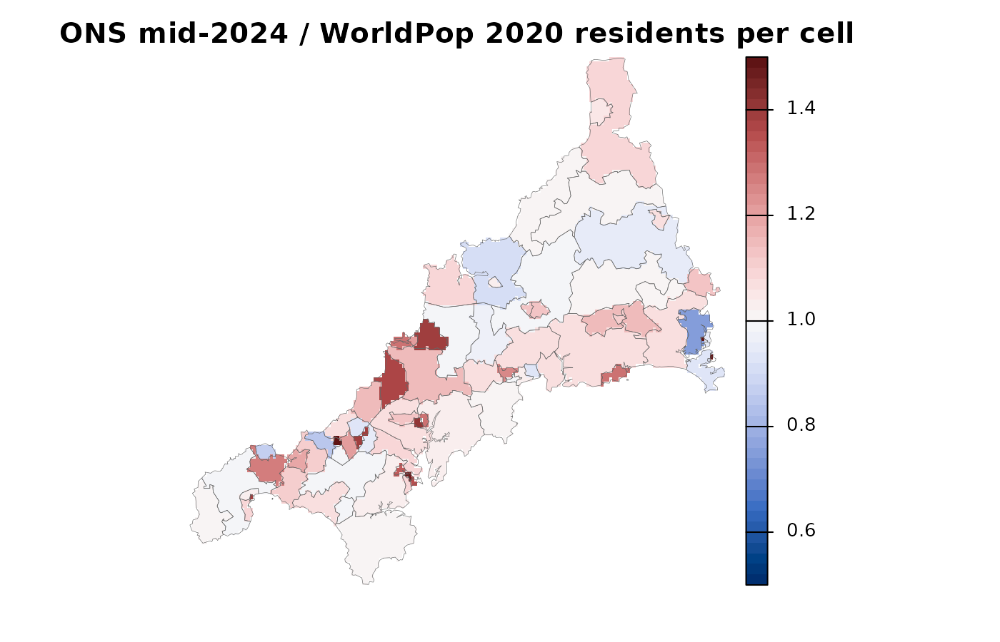

# Preparing your own data: counts, facility IDs and travel

This guide uses the bundled Cornwall GP data, described in [The Cornwall
GP example
data](https://songyosr.github.io/spax/articles/cornwall-data.md).

``` r

library(spax)
library(terra)
library(sf)
library(dplyr)
```

Every FCA or allocation analysis needs three aligned inputs: demand
counts at origins, supply at facilities, and travel between them. This
guide prepares them from the Cornwall data and shows three problems you
are likely to meet with your own data: facility IDs that must match,
unknown travel times, and demand that arrives as small-area totals
rather than a grid.

``` r

# WorldPop 2020 residents per cell
pop <- read_spax_example("cornwall_pop.tif")
# Travel minutes, one layer per practice
travel <- read_spax_example("cornwall_gp_travel.tif")
gp <- st_drop_geometry(cornwall_gp)

c(
  practices = nrow(gp),
  travel_layers = nlyr(travel),
  small_areas = nrow(cornwall_lsoa)
)
```

``` spax-output
    practices travel_layers   small_areas 
           55            55           337 
```

## Match facilities by ID, not by order

Each travel layer is named with the practice’s NHS code, the same code
as `cornwall_gp$practice`. Check that the two sets agree before any
calculation.

``` r

# Practice codes must be unique and match the travel layer names
stopifnot(
  !anyDuplicated(gp$practice),
  setequal(names(travel), gp$practice)
)
head(names(travel))
```

``` spax-output
[1] "L82001" "L82003" "L82004" "L82006" "L82007" "L82008"
```

When supply is a data frame,
[`spax_e2sfca()`](https://songyosr.github.io/spax/reference/spax_e2sfca.md),
[`spax_2sfca()`](https://songyosr.github.io/spax/reference/spax_2sfca.md),
[`spax_3sfca()`](https://songyosr.github.io/spax/reference/spax_3sfca.md)
and
[`spax_huff2sfca()`](https://songyosr.github.io/spax/reference/spax_huff2sfca.md)
match its rows to the travel layers through `id_col`, so the row order
does not matter.

``` r

# The E2SFCA surface for a given supply table
fit <- function(supply) {
  result <- spax_e2sfca(
    demand = pop,
    supply = supply,
    distance = travel,
    decay_params = list(method = "gaussian", sigma = 10),
    id_col = "practice",
    supply_cols = "gp_fte_extg"
  )
  result$accessibility
}

# Reversing the row order gives the same surface
shuffled <- arrange(gp, desc(practice))
all.equal(values(fit(gp)), values(fit(shuffled)))
```

``` spax-output
[1] TRUE
```

A named supply vector is also matched by name, but an unnamed vector or
a matrix is used in layer order: then keeping the order right is your
job. The number of supply rows must equal the number of travel layers.
Dropping a facility from one input and not the other stops with an
error:

``` r

# 54 travel layers, but 55 rows of supply
mainland_layers <- travel[[gp$practice[!gp$scilly]]]

tryCatch(
  spax_e2sfca(
    demand = pop,
    supply = gp,
    distance = mainland_layers,
    decay_params = list(method = "gaussian", sigma = 10),
    id_col = "practice",
    supply_cols = "gp_fte_extg"
  ),
  error = function(e) conditionMessage(e)
)
```

``` spax-output
[1] "Length of distance layers (54) must match length of facilities (55)"
```

## Decide what unknown travel means

Travel is `NA` where a cell is unpopulated, where there is no road
connection and for journeys over 180 minutes. In Cornwall the gaps come
from the Isles of Scilly: their practice cannot be reached by road from
the mainland, mainland practices cannot be reached from the islands, and
some cells on the smaller islands reach no practice at all.

``` r

# Count the cells with unknown travel in each practice's layer
missing_cells <- global(is.na(travel), "sum")[[1]]
table(scilly_practice = gp$scilly, missing_cells)
```

``` spax-output
               missing_cells
scilly_practice 28860 35750
          FALSE    54     0
          TRUE      0     1
```

``` r

# Cells with a road route to the Scilly practice (L82017) or to the
# mainland (here the first layer, a mainland practice)
road_scilly <- !is.na(values(travel[["L82017"]], mat = FALSE))
road_mainland <- !is.na(values(travel[[1]], mat = FALSE))

# Residents in each group
residents <- values(pop, mat = FALSE)
round(c(
  to_mainland = sum(residents[road_mainland]),
  to_scilly_practice = sum(residents[road_scilly]),
  no_road_link = sum(residents[!road_mainland & !road_scilly], na.rm = TRUE)
))
```

``` spax-output
       to_mainland to_scilly_practice       no_road_link 
            541184               1206                277 
```

The FCA functions drop unknown weights from their sums
([`gather_weighted()`](https://songyosr.github.io/spax/reference/gather_weighted.md)
defaults to `na.rm = TRUE`), so an `NA` travel time acts like “no
access”. Run on all 55 practices, the islands become a separate system
with one practice and few residents, so their index is far above the
mainland’s. The residents with no route drop out of that practice’s
demand and get no index at all.

``` r

# Index per 1,000 residents with all 55 practices
with_scilly <- 1000 * values(fit(gp), mat = FALSE)
round(
  c(
    mainland_median = median(with_scilly[road_mainland]),
    scilly_median = median(with_scilly[road_scilly])
  ),
  2
)
```

``` spax-output
mainland_median   scilly_median 
           0.49            7.59 
```

The islands do have access, by boat and air, which the road-based travel
times do not represent. Rather than read these numbers as access, the
FCA guides model **mainland Cornwall only**: the 54 mainland practices
and the cells with a travel time to every one of them.

``` r

# Mainland practices and their travel layers
gp <- filter(gp, !scilly)
travel <- travel[[gp$practice]]

# Keep cells with complete travel, then trim the empty margin
pop_mainland <- trim(mask(pop, sum(travel)))
travel <- crop(travel, pop_mainland)

# Same grid, same practice order, and no populated cell with unknown travel
stopifnot(
  compareGeom(pop_mainland, travel),
  identical(names(travel), gp$practice),
  !anyNA(values(travel)[!is.na(values(pop_mainland)), ])
)
round(global(pop_mainland, "sum", na.rm = TRUE)[[1]])
```

``` spax-output
[1] 541184
```

`sum(travel)` is `NA` wherever any layer is `NA`, so the mask keeps
exactly the cells with complete travel. The check confirms that no
populated cell has unknown travel left.

## Turn small-area counts into a demand grid

Demand often comes as totals for administrative areas. `cornwall_lsoa`
holds ONS mid-2024 population estimates for the 337 small areas (LSOAs).
To use them on the grid, each area’s total must be spread over its
cells. Spreading it uniformly would ignore where people live inside the
area, so we use the WorldPop grid as a pattern:
[`transform_pmf()`](https://songyosr.github.io/spax/reference/transform_pmf.md)
turns it into shares that sum to 1, and
[`transform_demand()`](https://songyosr.github.io/spax/reference/transform_demand.md)
rescales those shares so that each area keeps its own total.

``` r

# Mainland small areas as a terra vector in the grid's coordinates
areas <- cornwall_lsoa |>
  filter(!scilly) |>
  st_transform(crs(pop)) |>
  vect()

# The WorldPop grid as shares that sum to 1
pattern <- transform_pmf(pop)

# Spread each area's total over its cells; show any warning as a message
lsoa_grid <- withCallingHandlers(
  transform_demand(
    x = areas,
    value_col = "pop",
    pmf = pattern,
    density = TRUE
  ),
  warning = function(w) {
    message("Warning: ", conditionMessage(w))
    invokeRestart("muffleWarning")
  }
)
```

    Warning: 41 area(s) cover no grid cell or have zero weight; their counts are dropped and the surface is rescaled. Use larger areas or a finer template.

The grid cells are about 1 km across, and many town LSOAs are smaller
than that: an area whose polygon contains no cell centre cannot receive
its count, and the function warns rather than silently losing people.
The fix is to use larger areas or a finer grid. Here we merge LSOAs into
their middle-layer areas (MSOAs): an LSOA name ends in a letter, and
dropping it gives the MSOA name.

``` r

# Merge LSOAs into MSOAs, adding up their counts
areas$msoa <- sub("[A-Z]$", "", areas$name)
msoa <- aggregate(areas, by = "msoa", fun = "sum")

# Spread each MSOA total over its cells with the WorldPop pattern
ons <- transform_demand(
  x = msoa,
  value_col = "sum_pop",
  pmf = pattern,
  density = TRUE,
  full_output = TRUE  # also return the area totals
)

c(
  areas = nrow(msoa),
  ons_total = sum(msoa$sum_pop),
  grid_total = round(global(ons$surface, "sum", na.rm = TRUE)[[1]])
)
```

``` spax-output
     areas  ons_total grid_total 
        73     583289     583289 
```

``` r

# Largest difference between an area's total and its grid total
signif(max(abs(ons$totals$original - ons$totals$redistributed)), 2)
```

``` spax-output
[1] 0.00053
```

All 73 areas keep their totals: the largest error is a fraction of a
person. The new grid has the ONS counts with the WorldPop pattern inside
each area. The two sources differ in date and method, so the ratio
between them varies by area. The map caps the colour scale at 0.5 and
1.5.

``` r

# ONS count over WorldPop count in each cell, and its median per area
ratio <- crop(ons$surface / pop, msoa)
by_area <- extract(ratio, msoa, fun = median, na.rm = TRUE)[, 2]
round(summary(by_area), 2)
```

``` spax-output
   Min. 1st Qu.  Median    Mean 3rd Qu.    Max. 
   0.74    1.00    1.07    1.15    1.18    3.73 
```

``` r

plot(
  clamp(ratio, 0.5, 1.5),
  axes = FALSE,
  range = c(0.5, 1.5),
  col = hcl.colors(50, "Blue-Red 3"),
  main = "ONS mid-2024 / WorldPop 2020 residents per cell"
)
lines(msoa, lwd = 0.3, col = "grey40")
```



In most areas the ONS estimate is higher, and in one it is more than
three times the WorldPop count. Decide which source matches your
question and say which you used; do not mix them within one analysis.
The other FCA guides use the WorldPop grid directly.

Two more cautions. If a source raster is a density (people per square
kilometre), multiply it by
[`terra::cellSize()`](https://rspatial.github.io/terra/reference/cellSize.html)
in the same area unit before use: summing densities does not conserve
counts, and longitude-latitude cells are not all the same size. And
[`rasterize_demand()`](https://songyosr.github.io/spax/reference/rasterize_demand.md)
does a different job: it reweights a prior pattern by an area **rate**
and returns shares, not counts that respect area totals. For example,
the share of residents aged 65 and over:

``` r

# Share of residents aged 65 and over in each MSOA
msoa$share_65 <- msoa$sum_pop_65p / msoa$sum_pop

# Reweight the WorldPop pattern by that share; the result is shares
older <- rasterize_demand(
  x = msoa,
  value_col = "share_65",
  prior = pattern
)
older_counts <- older * sum(msoa$sum_pop_65p)

# Each area's grid total as a fraction of its known count
kept <- extract(older_counts, msoa, fun = sum, na.rm = TRUE)[, 2] /
  msoa$sum_pop_65p
round(quantile(kept, c(0, 0.5, 1)), 2)
```

``` spax-output
  0%  50% 100% 
0.29 1.01 1.46 
```

The shape is plausible (population times the local 65+ share), but area
totals are not kept: some areas end up with well under or over their
known count. For counts, use
[`transform_demand()`](https://songyosr.github.io/spax/reference/transform_demand.md).

## The same rules for allocation inputs

The experimental allocation workflow takes a numeric origin-by-facility
matrix, `cornwall_travel`, from small-area centroids to practices. Its
preparation is strict: unknown travel on an active origin is an error
unless you declare a policy.

``` r

# Named vectors: registered residents per area, GP FTE per practice
demand <- setNames(cornwall_lsoa$registered, cornwall_lsoa$lsoa)
supply <- setNames(cornwall_gp$gp_fte_extg, cornwall_gp$practice)

tryCatch(
  prepare_allocation(
    demand = demand,
    supply = supply,
    distance = cornwall_travel
  ),
  error = function(e) conditionMessage(e)
)
```

``` spax-output
[1] "active travel is missing; declare missing_travel = 'legacy_zero' to omit unknown edges"
```

`missing_travel = "legacy_zero"` would omit unknown pairs, as the FCA
functions do. Positive infinity declares a known absent link. Neither
describes the islands’ boat and air links, so we keep the mainland,
matching IDs by name:

``` r

mainland_area <- !cornwall_lsoa$scilly

inputs <- prepare_allocation(
  demand = demand[mainland_area],
  supply = supply[gp$practice],
  distance = cornwall_travel[mainland_area, gp$practice],
  # Unit labels are recorded with the inputs, not converted
  metadata = list(
    demand_units = "registered residents",
    supply_units = "GP FTE excluding GPs in training",
    travel_units = "minutes"
  )
)
class(inputs)
```

``` spax-output
[1] "ae_prepared_inputs"
```

The unit declarations are recorded, not converted. See the [allocation
workflow](https://songyosr.github.io/spax/articles/allocation-workflow.md)
for what the prepared inputs feed into.

## Continue

- [Comparing FCA
  methods](https://songyosr.github.io/spax/articles/fca-methods.md):
  E2SFCA, 2SFCA, M2SFCA, 3SFCA and Huff-2SFCA on these inputs.
- [The E2SFCA calculation step by
  step](https://songyosr.github.io/spax/articles/e2sfca-steps.md).
- [Grid resolution, support and computational
  cost](https://songyosr.github.io/spax/articles/grid-resolution.md).
