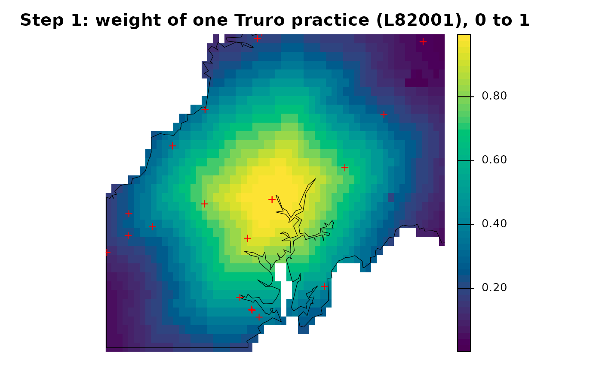
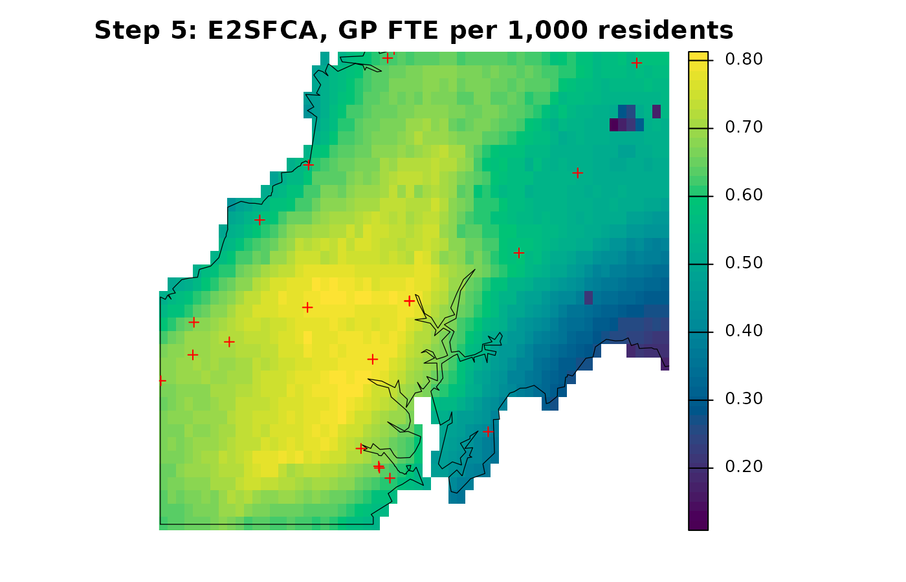

# The E2SFCA calculation step by step

This guide uses the bundled Cornwall GP data, described in [The Cornwall
GP example
data](https://songyosr.github.io/spax/articles/cornwall-data.md).

``` r

library(spax)
library(terra)
library(sf)
library(dplyr)
```

An FCA calculation has two kernels: one decides how much demand each
facility gathers, the other spreads each facility’s supply-to-demand
ratio back to origins. Let demand at cell $`i`$ be $`D_i`$, supply at
practice $`j`$ be $`S_j`$, and the demand-side and access-side weights
be $`G_{ij}`$ and $`H_{ij}`$. Then

``` math
L_j=\sum_i D_iG_{ij},\qquad R_j=S_j/L_j,\qquad A_i=\sum_j H_{ij}R_j.
```

This guide rebuilds the E2SFCA surface of [Getting
started](https://songyosr.github.io/spax/articles/spax.md) one step at a
time and checks each step against
[`spax_e2sfca()`](https://songyosr.github.io/spax/reference/spax_e2sfca.md),
with the same inputs and the same 10-minute Gaussian decay. The
calculation covers all of mainland Cornwall; the maps zoom in on the
area around Truro so that individual cells stay visible.

``` r

pop <- read_spax_example("cornwall_pop.tif")
travel <- read_spax_example("cornwall_gp_travel.tif")

# Mainland only, as in the other guides
gp <- cornwall_gp |>
  filter(!scilly) |>
  st_drop_geometry()
travel <- travel[[gp$practice]]
pop <- trim(mask(pop, sum(travel)))
travel <- crop(travel, pop)

# GP FTE named by practice code
supply <- setNames(gp$gp_fte_extg, gp$practice)

# Map helper: a layer within the Truro display window, with practices
truro <- ext(-5.30, -4.80, 50.12, 50.42)  # display window only
practices <- cornwall_gp |>
  filter(!scilly) |>
  st_transform(crs(pop)) |>
  vect()
show <- function(x, title) {
  plot(
    crop(x, truro),
    axes = FALSE,
    main = title,
    col = hcl.colors(50, "viridis")
  )
  points(crop(practices, truro), pch = 3, col = "red")
}
```

## Step 1: decay weights

With Gaussian decay, $`W_{ij}=\exp(-d_{ij}^2/2\sigma^2)`$, where
$`d_{ij}`$ is the travel time. We use $`\sigma = 10`$ minutes, a choice
rather than an estimate.
[`calc_decay()`](https://songyosr.github.io/spax/reference/calc_decay.md)
works on plain numbers and on rasters alike.

``` r

# The weight left after a few travel times
minutes <- c(0, 5, 10, 15, 20, 30)
kernel <- calc_decay(minutes, method = "gaussian", sigma = 10)
round(setNames(kernel, minutes), 3)
```

``` spax-output
    0     5    10    15    20    30 
1.000 0.882 0.607 0.325 0.135 0.011 
```

``` r

# The same decay applied to every travel layer
weights <- calc_decay(travel, method = "gaussian", sigma = 10)
show(
  weights[["L82001"]],
  "Step 1: weight of one Truro practice (L82001), 0 to 1"
)
```



Each practice has one weight layer. The map shows the layer for a
practice in central Truro (the red crosses are practices): the weight is
close to 1 near it and fades with travel time. The shape follows the
travel-time surface, not straight-line distance; the gaps are estuaries.

## Step 2 (optional): normalize the demand-side weights

The weights of all practices at one cell need not sum to 1. Where many
practices are close, each of them counts the same resident.
[`calc_normalize()`](https://songyosr.github.io/spax/reference/calc_normalize.md)
offers alternatives: `"standard"` divides each cell’s weights by their
sum, and `"semi"` does so only where the sum exceeds 1.

``` r

# Sum of all practices' weights at each cell
row_sum <- function(w) values(sum(w), mat = FALSE)
probs <- c(0.05, 0.5, 0.95)

standard <- calc_normalize(weights, method = "standard")
semi <- calc_normalize(weights, method = "semi")

# Cell quantiles of those sums, before and after normalizing
round(
  rbind(
    identity = quantile(row_sum(weights), probs, na.rm = TRUE),
    standard = quantile(row_sum(standard), probs, na.rm = TRUE),
    semi = quantile(row_sum(semi), probs, na.rm = TRUE)
  ),
  2
)
```

``` spax-output
           5%  50%  95%
identity 1.23 3.96 9.06
standard 1.00 1.00 1.00
semi     1.00 1.00 1.00
```

In mainland Cornwall the weights at the median cell sum to about 4, and
even the 5th percentile is above 1, so `"standard"` and `"semi"` give
almost the same result here and both differ from `"identity"`. The
choice changes the demand each practice gathers and so the index:
normalization is a model choice, not a correction. In
[`spax_e2sfca()`](https://songyosr.github.io/spax/reference/spax_e2sfca.md)
the `demand_normalize` argument (`normalize` in
[`spec_e2sfca()`](https://songyosr.github.io/spax/reference/spec_e2sfca.md))
applies it to the demand side only. We keep `"identity"`, so
$`G = H = W`$.

## Step 3: gather demand to practices

[`gather_weighted()`](https://songyosr.github.io/spax/reference/gather_weighted.md)
sums demand times weight over all cells for each practice:
$`L_j=\sum_i D_iW_{ij}`$. With `simplify = TRUE` it returns a vector
named by the weight layers.

``` r

load <- gather_weighted(
  values = pop,
  weights = weights,
  simplify = TRUE  # one named value per practice
)
stopifnot(identical(names(load), gp$practice))
```

## Step 4: supply-to-demand ratios

Each practice’s ratio is its supply over the demand it gathered,
$`R_j=S_j/L_j`$. Index supply by the names of `load`, not by position.

``` r

ratio <- supply[names(load)] / load

# Supply, gathered demand and ratio for six practices near Truro
near_truro <- c("L82001", "L82028", "L82015", "L82061", "L82045", "L82048")
data.frame(practice = near_truro) |>
  left_join(select(gp, practice, name), by = "practice") |>
  mutate(
    gp_fte = round(supply[practice], 1),
    weighted_residents = round(load[practice]),
    fte_per_1000 = round(1000 * ratio[practice], 2)
  )
```

``` spax-output
  practice                          name gp_fte weighted_residents fte_per_1000
1   L82001       LANDER MEDICAL PRACTICE   10.3              95347         0.11
2   L82028 THREE SPIRES MEDICAL PRACTICE   10.3              95347         0.11
3   L82015      CHACEWATER HEALTH CENTRE    3.7             105955         0.04
4   L82061          CARNON DOWNS SURGERY    5.3             100581         0.05
5   L82045                PROBUS SURGERY    6.6              71415         0.09
6   L82048            ROSELAND SURGERIES    3.3              42552         0.08
```

The ratios look small because, with identity weights, each resident is
counted by several practices; step 5 adds them back up. The two central
Truro practices share one site, so they gather the same demand.

[`spax_e2sfca()`](https://songyosr.github.io/spax/reference/spax_e2sfca.md)
uses a ratio of zero for a practice whose gathered demand is zero. That
is a computational convention, not evidence of anything; with Gaussian
weights every practice here gathers some demand, so it is not used.

## Step 5: spread the ratios back to cells

[`spread_weighted()`](https://songyosr.github.io/spax/reference/spread_weighted.md)
multiplies each practice’s ratio by its weight layer and sums over
practices: $`A_i=\sum_j W_{ij}R_j`$. It matches values to layers by
position, so pass the ratios in layer order.

``` r

# Ratios in layer order, without names: matching is by position
access <- spread_weighted(
  values = unname(ratio[names(weights)]),
  weights = weights
)
show(1000 * access, "Step 5: E2SFCA, GP FTE per 1,000 residents")
```



A cell’s index is a sum of contributions from every practice. For the
cell containing the central Truro practice, the largest contributions
are:

``` r

# The grid cell that contains practice L82001
site <- geom(practices[practices$practice == "L82001", ])
cell <- cellFromXY(pop, site[, c("x", "y"), drop = FALSE])

# Each practice's contribution: its weight at the cell times its ratio
w_cell <- unlist(extract(weights, cell))
parts <- sort(1000 * w_cell * ratio[names(w_cell)], decreasing = TRUE)

round(
  c(
    head(parts, 5),
    all_others = sum(parts[-(1:5)]),
    total = sum(parts)
  ),
  3
)
```

``` spax-output
    L82028     L82001     L82045     L82006     L82061 all_others      total 
     0.108      0.107      0.067      0.048      0.047      0.417      0.794 
```

## Check against the packaged functions

The step-by-step surface, the
[`spax_e2sfca()`](https://songyosr.github.io/spax/reference/spax_e2sfca.md)
wrapper, the more general
[`compute_access()`](https://songyosr.github.io/spax/reference/compute_access.md)
and a plain matrix calculation all agree:

``` r

# The packaged wrapper
e2sfca <- spax_e2sfca(
  demand = pop,
  supply = gp,
  distance = travel,
  decay_params = list(method = "gaussian", sigma = 10),
  demand_normalize = "identity",
  id_col = "practice",
  supply_cols = "gp_fte_extg"
)

# The general function, with the same weights on both sides
general <- compute_access(
  demand = pop,
  supply = supply,
  demand_weights = weights,
  access_weights = weights
)

# The same formula with plain matrices: cells in rows, practices in columns
W <- values(weights)
D <- values(pop, mat = FALSE)
ok <- !is.na(D)
manual <- rep(NA_real_, length(D))
manual[ok] <- drop(W[ok, ] %*% (supply / colSums(W[ok, ] * D[ok])))

# All three surfaces match the matrix calculation, and so do the loads
for (answer in list(access, e2sfca$accessibility, general)) {
  stopifnot(isTRUE(all.equal(
    values(answer, mat = FALSE),
    manual,
    tolerance = 1e-10,
    check.attributes = FALSE
  )))
}
stopifnot(isTRUE(all.equal(
  drop(load),
  colSums(W[ok, ] * D[ok]),
  check.attributes = FALSE
)))
```

The check verifies this calculation with these inputs; it does not make
different accessibility models equivalent.

[`spax()`](https://songyosr.github.io/spax/reference/spax.md) computes
the same index from a specification without data,
[`spec_e2sfca()`](https://songyosr.github.io/spax/reference/spec_e2sfca.md),
on data prepared once with
[`prep_data()`](https://songyosr.github.io/spax/reference/prep_data.md);
this interface is experimental. Its surface is identical to that of the
wrapper:

``` r

by_spec <- spax(
  prep_data(pop, gp, travel, id_col = "practice", supply_cols = "gp_fte_extg"),
  spec_e2sfca(decay = decay_gaussian(sigma = 10), normalize = "identity")
)
stopifnot(identical(
  values(by_spec$accessibility),
  values(e2sfca$accessibility)
))
```

## Why the calculation covers the whole mainland

Cropping the inputs to the Truro window before calculating would be
quicker, but every practice, including those outside the window, would
then gather only the demand inside it.

``` r

# Calculate on the Truro window only
cropped <- spax_e2sfca(
  demand = crop(pop, truro),
  supply = gp,
  distance = crop(travel, truro),
  decay_params = list(method = "gaussian", sigma = 10),
  demand_normalize = "identity",
  id_col = "practice",
  supply_cols = "gp_fte_extg"
)

# Compare with the full calculation over the same cells
in_window <- values(crop(e2sfca$accessibility, truro), mat = FALSE)
relative <- values(cropped$accessibility, mat = FALSE) / in_window - 1
round(quantile(100 * relative, c(0, 0.5, 1), na.rm = TRUE), 1)
```

``` spax-output
    0%    50%   100% 
  15.5   54.5 4980.0 
```

These are percentage differences between the cropped and the full
calculation for cells in the window. Every cell’s index rises: by about
half at the median and about fifty-fold at the worst cell, on the
window’s edge, which picks up practices outside the window whose small
remaining demand gives them very high ratios. Calculate on the full
study area and crop only for display.

## Change the access-side weights

[`spax_m2sfca()`](https://songyosr.github.io/spax/reference/spax_m2sfca.md)
keeps $`W`$ on the demand side but uses $`W^2`$ on the access side, so
$`G = W`$ and $`H = W^2`$. $`W^2`$ is below $`W`$ except at zero travel
time, and far below it for distant practices, so M2SFCA discounts cells
whose practices are far away. The same matrix formula reproduces it:

``` r

m2sfca <- spax_m2sfca(
  demand = pop,
  supply = gp,
  distance = travel,
  decay_params = list(method = "gaussian", sigma = 10),
  demand_normalize = "identity",
  id_col = "practice",
  supply_cols = "gp_fte_extg"
)

# M2SFCA by hand: squared weights on the access side only
m2_manual <- rep(NA_real_, length(D))
m2_manual[ok] <- drop(W[ok, ]^2 %*% (supply / colSums(W[ok, ] * D[ok])))
stopifnot(isTRUE(all.equal(
  values(m2sfca$accessibility, mat = FALSE),
  m2_manual,
  tolerance = 1e-10,
  check.attributes = FALSE
)))
```

[Comparing FCA
methods](https://songyosr.github.io/spax/articles/fca-methods.md) maps
E2SFCA, 2SFCA, M2SFCA, 3SFCA and Huff-2SFCA side by side and explains
why only M2SFCA loses part of the supply. None of these indices is a
fitted statistical model. An allocation model instead defines choice
probabilities with an outside option; see [Choosing an FCA index or an
allocation
model](https://songyosr.github.io/spax/articles/model-choice.md).
